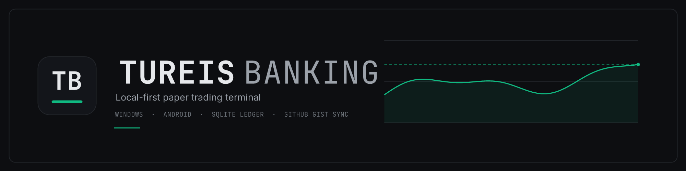
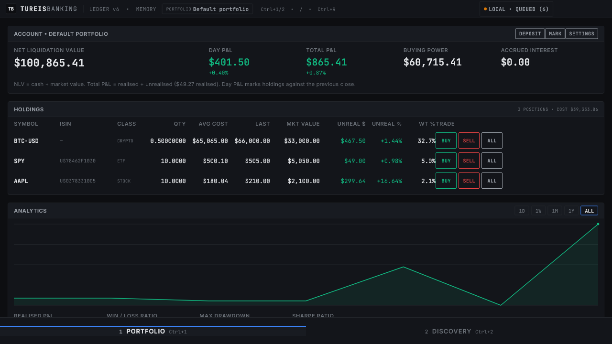
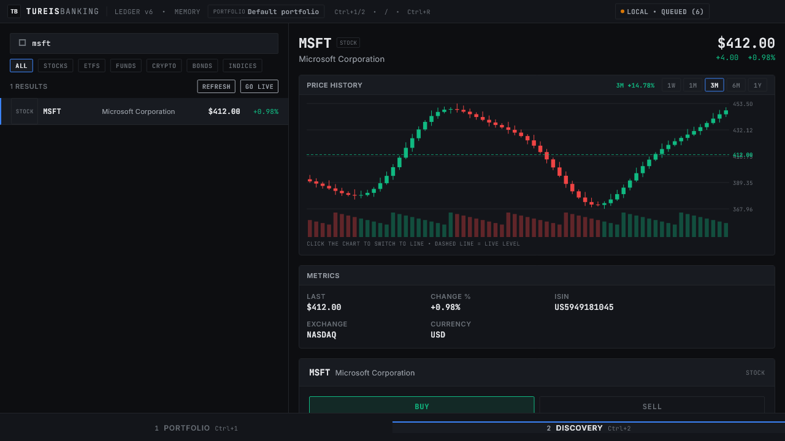
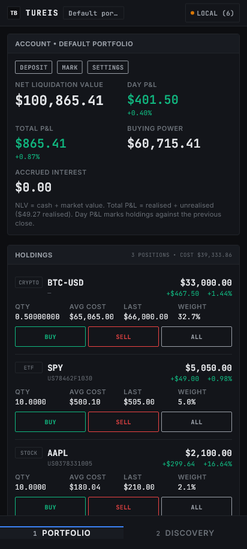
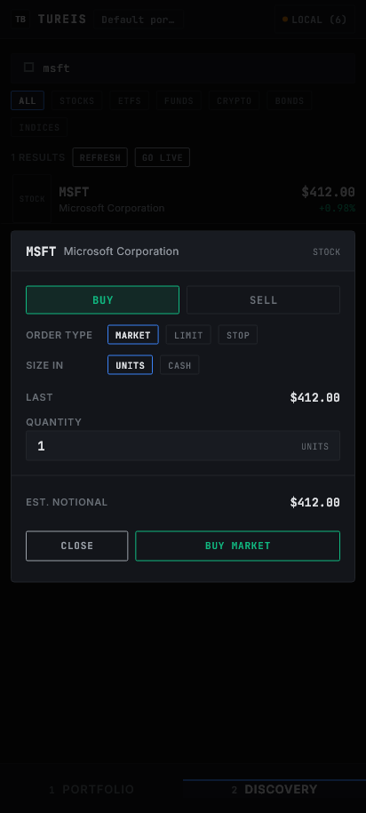
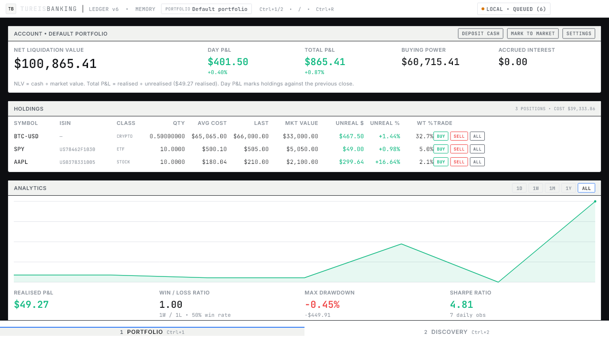

<p align="center">
  
</p>

<p align="center">
  <a href="https://github.com/tureisD/paper-trading-app/releases"></a>
  
  
  
  
  
</p>

<h3 align="center">A local-first paper trading terminal for Windows&nbsp;and&nbsp;Android</h3>

<p align="center">
  <em>Nearly twenty thousand instruments, real market data, your own append-only ledger —
  synced between your devices for free through a GitHub Gist you own.</em>
</p>

<p align="center">
  <sub>No backend · no sign-up · no subscription · your data stays yours · it never touches a real market</sub>
</p>

---

|  |  |
| :--- | :--- |
| **Instruments** | ~19,400 — US, Europe (every Yahoo-listed cash equity), Asia and the Americas, plus 26 global indices |
| **Asset classes** | Stocks · ETFs · Mutual funds · Crypto · Bonds · Indices |
| **Platforms** | Windows 10/11 (x64) · Android |
| **Market data** | Yahoo · Binance · FRED · ECB — **no API keys** |
| **Storage** | SQLite, append-only ledger, state derived by replay |
| **Sync** | Your own secret GitHub Gist — free forever, conflict-free |
| **Footprint** | 11 MB installer · ~31 MB installed |
| **Cost** | $0. No account, no server, nothing to renew |

---

## Screenshots

<p align="center">
  
  
</p>
<p align="center">
  
  
  
</p>

## Why this exists

I use **BestBrokers** on Android for paper trading and like it, but kept running
into small annoyances: I wanted the same portfolio on my PC *and* my phone, a dense
table that reads like a real terminal instead of a phone app stretched across a
monitor, real European and Asian listings (not just US tickers), a proper order
ticket with limit/stop orders, and analytics that are actually correct —
weighted-average cost, Sharpe, max drawdown, bond dirty pricing.

So this started as a **weekend project** to experiment with those things and improve
the basics: a free, synced broker simulator you own end to end. It grew a little
past the weekend, but the goal never changed — keep it small, local-first, and
honest about its numbers.

## Install

Grab the latest build from [**Releases**](https://github.com/tureisD/paper-trading-app/releases).

| Asset | Platform | Notes |
| :--- | :--- | :--- |
| `TureisBanking-*-windows-x64-setup.exe` | Windows 10/11 x64 | **11 MB installer.** Per-user (no admin prompt), Start-menu + desktop shortcuts, uninstaller. |
| `TureisBanking-*-android-arm64-v8a.apk` | Android | **Recommended**, ~20 MB. |
| `TureisBanking-*-android-armeabi-v7a.apk` | Android (older 32-bit) | ~17 MB. |
| `TureisBanking-*-android-x86_64.apk` | Emulators / x86 tablets | ~21 MB. |
| `TureisBanking-*-android-universal.apk` | Any Android device | ~55 MB, all ABIs. |
| `TureisBanking-*-android.aab` | Play Store upload | |

First launch seeds the instrument catalogue (about 19,000 rows, ~0.35 s) and opens a
portfolio with **$100,000** of simulated cash.

> [!NOTE]
> Android release builds are debug-key signed, so Android will warn when
> sideloading. That is fine for personal use — add your own keystore before
> distributing.

### The 30-second tour

1. **Portfolio** — net liquidation value, day and total P&L, holdings, equity curve
   and risk metrics. Hit **RELOAD** (or `F5`) to pull fresh prices for everything
   you hold.
2. **Discovery** — search 19,000 instruments offline, inspect the chart and metrics,
   and trade from the split pane.
3. **Settings** — themes, multiple named portfolios, add or remove cash.

---

<details>
<summary><b>✨ &nbsp;Feature list</b></summary>
<br>

### Trading

- **~19,400 instruments** — the complete US symbol directory (NASDAQ, NYSE, NYSE
  American, NYSE Arca, Cboe, IEX), every European cash equity Yahoo lists (Xetra,
  Euronext, LSE, SIX, Nasdaq Nordic, Borsa Italiana, BME, GPW, Athens, Budapest,
  Dublin, Istanbul, Vienna), curated Asia/Americas listings and 26 global indices.
  Instant offline search over symbol, name and ISIN.
- **Multiple named portfolios**, each with its own ledger, cash, holdings and
  history — all synced together.
- **Cash in and out** — deposit, withdraw a specific amount, or clear all cash.
- **Asset-correct execution**
  - *Equities/ETFs* — market, limit and stop orders, fractional quantities,
    simulated bid/ask spread.
  - *Crypto* — 24/7, 1e-8 precision, 0.10% maker/taker fee.
  - *Funds* — intraday orders queue as `QUEUED_NAV` and settle at the next EOD NAV.
  - *Bonds* — quoted clean, settled at dirty price, coupons credited automatically
    and exactly once.
- **Quick actions** — `BUY` / `SELL` (half, snapped to lot size) / `ALL` on every
  holdings row.

### Data

- **Keyless market data** — Yahoo Finance (stocks/ETFs/funds/indices), Binance
  (REST **and** a live WebSocket stream), FRED (US Treasury yields), ECB (euro-area
  yields).
- **Live streaming with frame coalescing** — ticks are buffered and flushed at most
  once per frame (60 Hz, or 120 Hz), so a fast stream can't block the UI.
- **On-command reload** — fetch fresh prices for everything held and recompute every
  derived number (`RELOAD` or `F5`).

### Analytics

- Weighted Average Cost basis, realised vs unrealised P&L, day P&L.
- Equity curve (1D/1W/1M/1Y/ALL) from **daily marked-to-market snapshots**.
- Maximum drawdown, Sharpe ratio (with a sovereign yield as the risk-free rate),
  win/loss ratio, asset allocation.

### Sync

- **Free forever** through one secret GitHub Gist you own.
- **Automatic** — a debounced push runs a couple of seconds after every trade,
  deposit or withdrawal, and both devices poll every 45 s while the app is open.
  A **SYNC** button is always in the header for an immediate pull + push.
- Hybrid logical clocks, append-only per-device monthly shards, conflict-free by
  construction.
- Token encrypted at rest with Windows DPAPI; conditional `GET`s cost zero
  rate-limit budget.

### Interface

- **Two themes** — matte carbon and crisp paper.
- **Responsive** — phone cards vs. desktop tables, safe areas, keyboard-first on
  desktop, thumb-first on mobile.
- No gradients, no glassmorphism, no decorative animation. Tabular numerals
  everywhere so numbers never jitter.

</details>

<details>
<summary><b>🖥️ &nbsp;Using the app</b></summary>
<br>

### Tab 1 — Portfolio

| Area | What it does |
| :--- | :--- |
| **Account header** | Net Liquidation Value, Day P&L, Total P&L, Buying Power, Accrued Bond Interest Receivable |
| **RELOAD** | Fetches fresh quotes for every holding, records today's valuation, recomputes the table, analytics and curve. Shows `PRICES UPDATED 17:42:05 • 3 QUOTES`. Also `F5`. |
| **Holdings** | Symbol, ISIN, class, quantity, average cost, last price, market value, unrealised $/%, weight |
| **Quick trade** | `BUY` / `SELL` / `ALL` per row, pre-filling the ticket |
| **Analytics** | Equity curve, realised P&L, win/loss, max drawdown, Sharpe, allocation |
| **Settings** | Theme, portfolios, add funds, remove funds |

### Tab 2 — Discovery

- **Search** tickers, names or ISINs instantly, offline.
- **Category pills** — All / Stocks / ETFs / Funds / Crypto / Bonds / Indices.
- **Detail sheet** (split pane on wide screens) — price header, history chart, asset
  metrics, order ticket.
- **Chart** — candlesticks with volume or a line; **click the chart to toggle**. A
  dashed line marks the live price and the header shows the change across the
  selected window (`1W` uses hourly bars).
- **Metrics adapt to the asset class** — expense ratio for ETFs/funds, 24h
  high/low/volume for crypto, and yield, coupon, maturity, computed YTM and modified
  duration for bonds.

### Order ticket

Buy/sell · market, limit or stop · sized in **units or cash**. Market orders fill
immediately; limit and stop orders rest locally and are re-evaluated on every quote
update; fund orders queue for the next end-of-day NAV.

### Settings

- **Appearance** — dark or light.
- **Portfolios** — create, rename, switch, remove. Removing is *local*; if the
  portfolio has already synced, another device will upload it again.
- **Add funds** — any amount, with quick presets.
- **Remove funds** — a specific amount, or **CLEAR ALL CASH**. Both are ledger
  events, so they sync and stay visible in history.

### Keyboard (desktop)

| Key | Action |
| :--- | :--- |
| `Ctrl+1` / `Ctrl+2` | Switch tab |
| `/` | Jump to search |
| `F5` | Reload portfolio prices |
| `Ctrl+R` | Refresh Discovery quotes |
| `Esc` | Dismiss |

</details>

<details>
<summary><b>🔄 &nbsp;Cross-device sync</b></summary>
<br>

Portfolio history syncs through **one secret GitHub Gist that you own**.

### Setup

1. Create a token with the **`gist`** scope (classic PAT), or the **Gists: read and
   write** account permission (fine-grained PAT).
2. In the app, click the status pill (top right) or **SYNC (GIST VAULT) → SETUP /
   SYNC**.
3. Paste the token, **leave the gist id blank** to create a vault, then **CONNECT &
   SYNC**. The pill turns green: `SYNCED • GIST • 12ms`.
4. On a second device, paste the same token and **the gist id from step 3**.

### How it works

- **Automatic cadence** — a debounced push ~2 s after the last local write, a full
  pull + push every 45 s while the app is open, and one on launch. The **SYNC**
  button (header) or **SYNC NOW** (vault panel) forces it immediately.
- Only **events** travel. Balances, cost basis and P&L are recomputed locally, so two
  devices can never disagree about state.
- Every event carries a **UUIDv7** id and a **Hybrid Logical Clock** stamp, which
  stays monotonic even if device clocks disagree.
- Each device writes **only its own monthly shard** (`ledger.<device>.<yyyy-MM>.ndjson`),
  so devices cannot overwrite each other and no file grows without bound.
- All portfolios live in the same vault; `account_id` on each event keeps them apart.
- Pulls are conditional (`If-None-Match`); a `304` costs **zero** rate-limit budget
  and unchanged shards are skipped by content hash.
- Rate limits are respected automatically (`Retry-After` / `x-ratelimit-reset`).
- The token is encrypted at rest with **Windows DPAPI** (user-scoped).
- Resting limit/stop orders stay **device-local**; only fills sync.

### When it says no

The app verifies the token before touching the vault, so it can tell you what is
actually wrong.

| Message | Meaning |
| :--- | :--- |
| `Paste a GitHub token first` | The field was empty — no request is sent. |
| `invalid or expired` (401) | GitHub rejected the credential. Create a new token. |
| `valid … but it has no "gist" scope` | Token works, permission is missing. |
| `returned 404` | Wrong gist id, or a fine-grained token without the Gists permission. |
| `OFFLINE • QUEUED (n)` | Rate limited or offline; it retries automatically. |

> [!TIP]
> Pasted whitespace, non-breaking spaces, zero-width characters and smart quotes are
> stripped before the token is ever sent — they are the usual cause of a 401 from a
> token that looks correct.

</details>

<details>
<summary><b>📈 &nbsp;Market data</b></summary>
<br>

All providers are keyless. Quotes are display data — never ledger data — and are
never synced.

| Asset class | Provider | Source |
| :--- | :--- | :--- |
| Stocks, ETFs, Funds, Indices | `yahoo` | `query1.finance.yahoo.com` chart API |
| Crypto | `binance` | REST (`api.binance.com`, `api.binance.vision` mirror) + WebSocket |
| US Treasury yields | `fred` | `fred.stlouisfed.org/graph/fredgraph.csv` |
| Euro-area yields | `ecb` | `data-api.ecb.europa.eu` (SDMX CSV) |

Adding a keyed provider (Finnhub, Alpaca, Polygon, Twelve Data) means implementing one
interface and registering it — the UI does not change.

</details>

<details>
<summary><b>🏗️ &nbsp;How it's built</b></summary>
<br>

### Stack

| Layer | Choice |
| :--- | :--- |
| UI | Flutter 3.47, AOT-compiled, Impeller/Skia rendering |
| Storage | SQLite via `package:sqlite3` 3.x (native binaries bundled through build hooks) |
| Networking | `package:http`, `dart:io` WebSocket |
| Secrets | Windows DPAPI through `dart:ffi` |
| Plugins | **None** — everything is Dart or FFI |

### Layout

```
lib/
  analytics/   portfolio metrics, equity curve + snapshots, trade statistics
  core/        ids (UUIDv7), UTC date helpers, formatting
  data/        SQLite database, versioned schema, ledger repository, settings
  design/      design tokens + palette, Material theme, theme controller, layout
  features/    common primitives, home shell, portfolio, discovery, trade,
               sync, settings
  market/      asset classes, providers, catalog + FTS5 search, quote cache,
               live streaming (coalescer, Binance WebSocket)
  sync/        HLC, shard codec, gist client, config store, sync engine, token
  trading/     ledger replay, WAC accounting, matching engine, bond math
tool/          catalog generator, NSIS installer
```

### The central idea: replay, don't store

The portfolio is an **append-only ledger of events**:

```
CASH_DEPOSIT · CASH_WITHDRAWAL · BUY · SELL · BOND_COUPON
```

`PortfolioEngine.replay` folds that log into cash, positions (Weighted Average Cost)
and realised P&L. `positions_cache` is a disposable materialisation of that fold;
delete it and nothing is lost. That is what makes sync easy — there is no state to
merge, only events to insert once.

### Schema (SQLite, migrated forward via `PRAGMA user_version`)

| Table | Purpose |
| :--- | :--- |
| `ledger_events` | Append-only log: UUIDv7, HLC stamp, `account_id`, meta JSON |
| `instrument_search` | FTS5 index over symbol / name / ISIN |
| `instruments` | Catalog: class, exchange, currency, ISIN, provider, expense ratio |
| `bond_details` | Coupon rate, maturity, par, frequency, day count |
| `quotes` | Latest quote per symbol (device-local cache) |
| `accounts` | Portfolios (id, name, base currency) |
| `pending_orders`, `positions_cache` | Working book and replay cache |
| `bond_coupon_credits` | Idempotency ledger for coupon payments |
| `equity_snapshots` | Daily marked-to-market valuations, per portfolio |
| `sync_state` | Vault config, ETags, shard hashes, UI settings |

### Decisions worth calling out

- **Replay over mutation** — identical state on any device, no conflict resolution,
  no merge UI.
- **Zero plugins** — everything is Dart or `dart:ffi`, so Windows Developer Mode is
  never required and the token goes straight to DPAPI.
- **Shard per device per month** — removes write contention and gives rotation for
  free.
- **UTC-stable dates** — `DateTime.parse('2030-01-15')` is *local* and shifts by a
  day; every schedule goes through `parseDateUtc`.
- **Coalesced ticks** — one UI update, one cache write and one order-evaluation pass
  per frame (60/120 Hz).
- **Bulk seeding** — prepared statements in a single transaction: 19k instruments in
  ~0.2 s instead of ~15 s.

### Footprint

The Windows installer is **~11 MB** (LZMA-solid NSIS) and installs about **31 MB**.
That floor is the engine, not the app:

| Component | Size | Notes |
| :--- | :--- | :--- |
| `flutter_windows.dll` | 21 MB | Flutter engine — fixed cost, already stripped |
| `data/app.so` | 5.9 MB | Dart AOT snapshot of this app |
| `sqlite3.dll` | 1.7 MB | Bundled SQLite (native assets) |
| assets | 1.3 MB | Fonts ~1 MB + catalogs ~163 KB |
| exe + uninstaller | 0.8 MB | Runner + uninstaller |

The catalog is the part that is ours, so it is the part that got optimised: the
instrument lists ship **gzipped and stripped of defaulted fields** (provider `yahoo`,
currency `USD`, `providerSymbol` == symbol), taking them from **2.0 MB to 163 KB**.

Getting dramatically below ~30 MB would mean not shipping the Flutter engine — i.e. a
different stack (Tauri/webview is ~5–10 MB) — which is a rewrite.

</details>

<details>
<summary><b>🧮 &nbsp;The maths</b></summary>
<br>

### Position accounting — Weighted Average Cost

Unlike FIFO, WAC treats all units of an instrument as fungible. Cost basis is
recalculated only when a position grows; realised P&L locks in when it shrinks.

```
buy:   avg_cost = (qty_held * avg_cost + qty_bought * price + fee)
                  / (qty_held + qty_bought)

sell:  realised += qty_sold * (price - avg_cost) - fee
       avg_cost unchanged
```

### Unrealised and total P&L

```
unrealised      = qty * (market_price - avg_cost)
unrealised_pct  = (market_price - avg_cost) / avg_cost * 100
total_pnl       = realised + unrealised
total_pnl_pct   = total_pnl / net_deposits * 100
day_pnl         = sum(qty * (price - previous_close))
net_liquidation = cash + sum(qty * market_price)
```

### Portfolio weight

```
w_i = (qty_i * price_i) / (cash + sum(qty_j * price_j))
```

### Sharpe ratio

```
S_p = (mean(periodic_return) - risk_free_periodic) / stdev(returns) * sqrt(K)
```

`K` is 252 for equity trading days, 365 for 24/7 crypto. The app uses daily
observations, a short-dated sovereign yield as the risk-free rate when one is cached,
and reports `—` until there are at least three days of history.

### Maximum drawdown

```
MDD = min over t of ( E_t - max_{τ<=t} E_τ ) / max_{τ<=t} E_τ
```

The worst peak-to-trough decline of portfolio equity, shown both as a percentage and
an amount.

### Fixed income — clean vs dirty price

Trading screens quote the **clean price**; settlement uses the **dirty price**.

```
dirty = sum_{k=1..M} (C/m) / (1 + y/m)^(k - v)  +  F_par / (1 + y/m)^(M - v)
dirty = clean + accrued_interest
accrued_interest = (C/m) * (days_elapsed / days_in_period)
```

- `C` annual coupon (`c * par`), `m` payments per year, `y` yield to maturity, `M`
  remaining periods, `v` fraction of the current period elapsed.

Yield to maturity is solved by bisection on the price function, and **modified
duration** estimates rate sensitivity:

```
modified_duration = macaulay_duration / (1 + y/m)
ΔP/P ≈ -modified_duration * Δy
```

`BondMath.modifiedDuration` is validated against numeric differentiation of the price
function in the test suite.

> The original design document carried a Python reference implementation of the
> engine. It has been superseded: `lib/trading/portfolio_engine.dart` and
> `lib/trading/trading_engine.dart` are authoritative, and the tests assert the same
> formulas.

</details>

<details>
<summary><b>🎨 &nbsp;Design system</b></summary>
<br>

Institutional trading-terminal ergonomics, deliberately anti-"AI template": no
gradients, no glassmorphism, no glowing blobs, no oversized rounded cards, no
unlabelled sparklines.

- **Typography** — `Inter` for UI and labels, `JetBrains Mono` for prices, tickers and
  quantities with `font-variant-numeric: tabular-nums` so digits align and never jitter
  on live ticks. Both bundled offline.
- **Surfaces** — matte carbon `#0D0E11` / panel `#13151A` / raised `#181B21`; light
  theme paper `#F7F7F5`. **1px hairline** borders (`#22252A`) instead of drop shadows.
- **Semantic colour only** — muted emerald `#10B981` strictly for positive P&L and
  bids, muted crimson `#EF4444` strictly for negative P&L and asks, amber `#D97706`
  only for offline/queued. Structural chrome is neutral slate.
- **Geometry** — 4px spacing scale, 2/4/6px radii, no elevation.
- **Theming** — surface/text tokens are palette-driven (`AppPalette`), so switching
  appearance never changes geometry or meaning.

</details>

<details>
<summary><b>🗺️ &nbsp;Roadmap &amp; status</b></summary>
<br>

All seven planned phases are implemented. The build started from the plan below and
deviated where the plan met reality — recorded here rather than quietly dropped.

| Phase | Planned | As built |
| :--- | :--- | :--- |
| **1** | Flutter/Tauri, SQLite + WAL, design tokens | ✅ Flutter 3.47, `package:sqlite3` 3.x via build hooks, Inter + JetBrains Mono, **zero plugins** |
| **2** | Finnhub/Alpaca/Polygon, Binance, Yahoo, FRED, ECB, 50k FTS5 index | ✅ **Keyless-first**: Yahoo, Binance REST **and WebSocket**, FRED, ECB. **~19,400 instruments** seeded in ~0.35 s |
| **3** | Accounts, ledger, position cache, pending orders, asset-specific rules | ✅ Schema v3 tables, WAC replay, market/limit/stop, fractional equity lots, crypto 1e-8 + 0.10% fee, fund `QUEUED_NAV`, bond clean→dirty + idempotent coupons |
| **4** | HLC stamping, Turso/Cloudflare/Gist, status pill | ✅ **Gist-only by design.** HLC + UUIDv7, per-device monthly NDJSON shards, ETag conditional GET, shard-hash checkpoints, rate-limit auto-retry, DPAPI token |
| **5** | Summary header, holdings table, analytics drawer | ✅ Plus **sell-all / partial-sell / buy-more**, **multiple named portfolios**, **cash withdrawals**, daily `equity_snapshots`, risk-free rate, **dark/light themes**, custom funding |
| **6** | Categorised search, split-pane detail sheet, order ticket | ✅ Split pane ≥900px, candle **and** line chart (click to toggle), dashed live price, per-window % change, `1W` hourly bars, expense ratios, YTM + modified duration, units⇄cash |
| **7** | Frame throttling, `.exe`/`.msix`, R8 `.apk`/`.aab` | ✅ `QuoteBatcher` (60/120 Hz), live stream with reconnect, **11 MB Windows installer**, release APK (R8) + obfuscated AAB. **MSIX skipped** (needs a signing certificate) |

### Deliberately not done

- **Resting-order sync across devices** — pending orders stay on the device that
  placed them. Making them travel means recording `ORDER_PLACED` / `ORDER_CANCELLED` /
  `ORDER_FILLED` as ledger events and deciding cross-device cancel/partial-fill
  semantics first. The `ledger_events.meta` column is the hook.
- **Keyed data providers** — no API keys were available; the interface is ready.
- **A licensed 50k+ dataset** — the bundled ~19,400 cover the listed universe; a full
  global dataset needs a licensed source.
- **MSIX** — requires a signing certificate; the portable folder remains an option for
  people who cannot install.

</details>

<details>
<summary><b>🧪 &nbsp;Development</b></summary>
<br>

### Requirements

- [Flutter](https://docs.flutter.dev/get-started/install) 3.47.7 stable or newer
- **Windows:** Visual Studio 2022 with *Desktop development with C++*
- **Android:** Android SDK (platform 35+), build-tools, JDK 17

The app uses **zero Flutter plugins**, so it builds without enabling Windows Developer
Mode. Adding a plugin will require it.

### Run

```bash
flutter pub get
flutter run -d windows      # or: flutter run -d <android-device>
```

### Test

```bash
flutter analyze
flutter test
```

Covers the accounting and matching engine (WAC, fees, slippage, lot precision,
resting/stop orders, fund NAV settlement, bond accrual and coupon idempotency),
portfolio isolation and cash withdrawals, portfolio analytics, sync (two-device
convergence against a fake gist, ETag/304, rate-limit translation, token diagnostics),
streaming (coalescing with `fake_async`, Binance parsing) and the providers (mocked
HTTP).

Optional live checks, excluded from normal runs:

```bash
TB_GIST_TOKEN=... flutter test test/sync_smoke.dart          # real gist round-trip, self-cleaning
TB_LIVE=1         flutter test test/live_stream_smoke.dart   # real Binance WebSocket
TB_SEED=1         flutter test test/catalog_seed_smoke.dart  # catalog seed timing
RENDER_SCREENSHOTS=1 RENDER_OUT=shot.png flutter test test/render_screenshots.dart
#   add RENDER_SIZE=412x915 for the phone layout and RENDER_VIEW=discovery for tab 2
```

### Build releases

```bash
flutter build windows --release
makensis tool/installer.nsi                    # -> build/dist/*-setup.exe

flutter build apk --release                    # universal APK
flutter build apk --release --split-per-abi    # per-ABI APKs (recommended)
flutter build appbundle --release --obfuscate --split-debug-info=build/app/outputs/symbols
```

### Tooling

- `tool/build_catalog.js` — regenerates the instrument catalogs. Downloads the official
  NASDAQ Trader symbol directory, strips defaulted fields and writes gzipped assets.
  Curated international listings live in `tool/markets.js`.
- `tool/fetch_eu_listings.js` — enumerates every European cash equity Yahoo lists
  (Xetra, Euronext, LSE, SIX, Nasdaq Nordic, Borsa Italiana, BME, GPW, Athens,
  Budapest, Dublin, Istanbul, Vienna), caches the result in `tool/.cache/` and drops
  bonds, certificates and cross-venue duplicates. Run it before the catalog build to
  refresh European coverage.
- `tool/installer.nsi` — the NSIS installer.

</details>

<details>
<summary><b>⚠️ &nbsp;Data, caveats &amp; limitations</b></summary>
<br>

- Listings derive from the public **NASDAQ Trader symbol directory** plus a curated
  international set and a generated sweep of European venues; Yahoo symbols encode
  the venue suffix (`.DE`, `.PA`, `.L`, `.T`, `.HK`, `.NS`, …).
- Market data comes from each provider's public endpoints and is subject to their
  terms. This is a **simulation** — no orders ever reach a real market.
- **London (`.L`) prices arrive in pence, not pounds.**
- Indices are tradable as synthetic instruments with no contract specification.
- Release Android builds are **debug-key signed**; add a keystore before distributing.
- The Windows uninstaller keeps your data (`%APPDATA%\PaperTradingApp`) on purpose.
- Removing a portfolio is local: if it has already synced, another device will upload
  it again.

</details>

---

<p align="center">
  <sub>
    Built with Flutter · Not affiliated with BestBrokers ·
    <a href="https://github.com/tureisD/paper-trading-app/releases">Releases</a> ·
    <a href="https://github.com/tureisD/paper-trading-app/issues">Issues</a>
  </sub>
</p>

<p align="center">
  <sub>Personal project, provided as-is for experimentation. Market data belongs to the respective providers.</sub>
</p>
